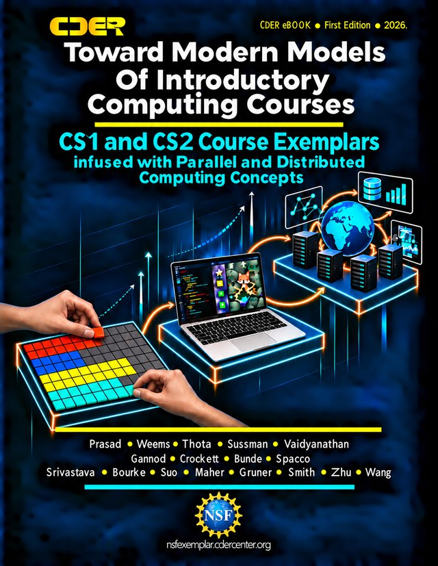
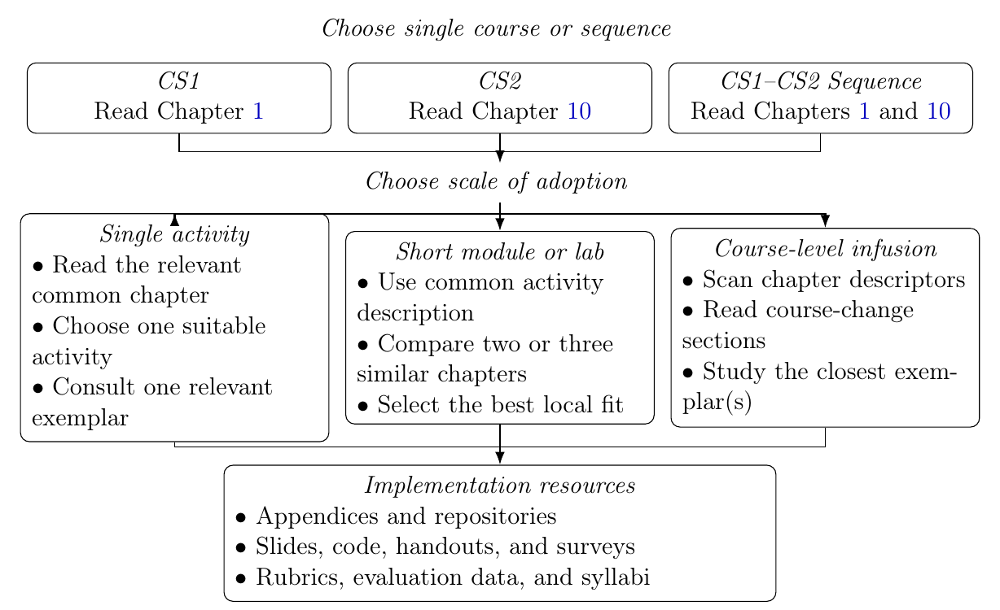
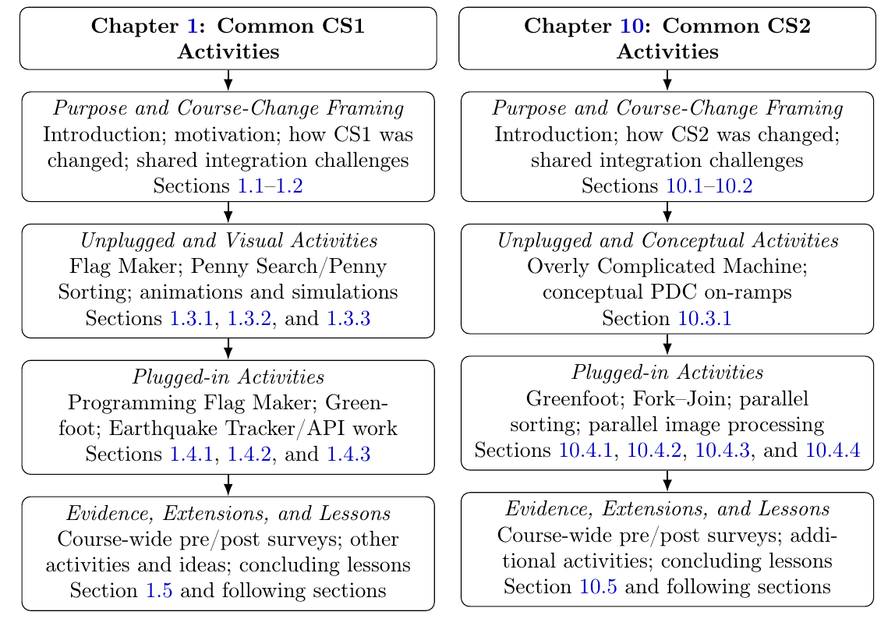
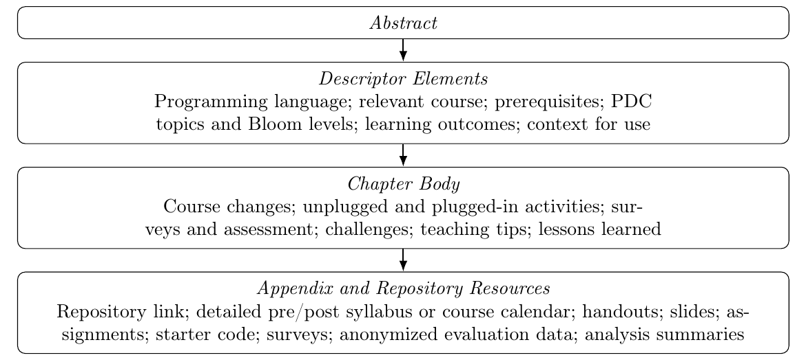
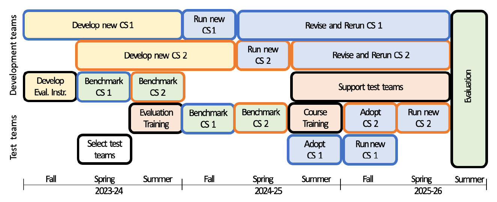

# Toward Modern Models of Introductory Computing Courses — Instructional Material

  

Classroom-ready material for the CDER Center e-book *Toward Modern Models of Introductory Computing
Courses: CS1 and CS2 Course Exemplars infused with Parallel and Distributed Computing Concepts*
(First Edition, November 2026). Eight institutions infused parallel and distributed computing (PDC)
into their own CS1 and CS2 courses, measured whether it worked, and published the syllabi, activities,
code, surveys and evaluation data here — sixteen course exemplars in all, ready to adapt.

- **E-book site:** <https://nsfexemplar.cdercenter.org/ebook> — chapter summaries, an activity finder,
  and the full PDF
- **DOI (First Edition):** [10.14809/20.500.12588/7992.2](https://doi.org/10.14809/20.500.12588/7992.2)
- **DOI (early release, August 2026, CS1 only):** [10.14809/4mcf-5jmt](https://doi.org/10.14809/4mcf-5jmt)

The chapters in the book describe the activities and what happened when they were taught. This
repository holds what you teach from.

## Where to start

1. **Pick the course.** For CS1, read **Chapter 1** of the e-book; for CS2, **Chapter 10**. These two
   common chapters distill the activity families shared across institutions — Flag Maker, Penny Sorting,
   Greenfoot and remote-data work in CS1; Fork–Join, parallel sorting and parallel image processing in
   CS2 — and point to every institution that ran each one. They live in the book only; their material is
   in the institutional folders below.
2. **Pick the closest institution.** Match on language, class size, calendar and preparation time
   rather than on institution type. The tables below are a starting filter.
3. **Open its folder.** Each chapter's folder follows the same layout, so material is where you expect
   it whichever exemplar you open.

  
   <em>Suggested reading paths by course and scale of adoption (Chapter 0, Figure 2).</em>

The two common chapters share one outline, so an activity family can be followed from CS1 into CS2:

  
   <em>Organization of Chapters 1 and 10 (Chapter 0, Figure 3).</em>

## Folder layout

Every institutional chapter in the book has the same structure, and its appendix is what the matching
folder here holds:

  
   <em>Common structure of the institutional chapters (Chapter 0, Figure 4).</em>

Each chapter folder is named `chapterN-INSTITUTION`, matching the chapter number in the e-book, and
contains:

| Folder | What is in it |
|---|---|
| `Detailed_Pre_and_Post_Syllabus/` | The course before and after, with a description of the changes made |
| `Unplugged_Activities/` | Activity guides, worksheets, handouts and facilitator resources |
| `Plugged_Activities/` | Programming exercises, source and starter code, lab activities |
| `Evaluation_Data_and_Analysis/` | Survey instruments, anonymized responses, evaluation metrics and analyses |
| `Optional_Archive/` | Earlier syllabi and schedules, so baseline and intervention terms can be compared |

Many folders also have a `README.md` and a `COURSE_CALENDAR.md` with the day-by-day schedule and
links to the material used. Student-level data is published only where consent allowed; otherwise the
chapter reports aggregate results.

## Guide to the chapters

Page numbers are the printed pages of the First Edition; each link opens the e-book at that chapter.

### Part I — CS1

Start with [Chapter 1, Common CS1 Activities and Lessons](https://nsfexemplar.cdercenter.org/download.php?f=book&p=28) (p. 28).

| Ch. | Institution | Language | Good starting point for | Folder |
|---|---|---|---|---|
| [2](https://nsfexemplar.cdercenter.org/download.php?f=book&p=65) | Tennessee Technological University | C++ | Large-section CS1; unplugged Penny and Flag Maker, OpenMP, remote-data/API assignment | [`CS1/chapter2-TTU`](CS1/chapter2-TTU) |
| [3](https://nsfexemplar.cdercenter.org/download.php?f=book&p=105) | Knox College | Java | Liberal-arts setting and small classes; Flag Maker, Greenfoot, Knoxcraft | [`CS1/chapter3-Knox`](CS1/chapter3-Knox) |
| [4](https://nsfexemplar.cdercenter.org/download.php?f=book&p=123) | University of Southern Indiana | Java | Structured adoption with evidence-rich unplugged and plugged-in activities | [`CS1/chapter4-USI`](CS1/chapter4-USI) |
| [5](https://nsfexemplar.cdercenter.org/download.php?f=book&p=163) | University of Nebraska–Lincoln | C, Java | Large or online courses; codeless and low-code modules | [`CS1/chapter5-UNL`](CS1/chapter5-UNL) |
| [6](https://nsfexemplar.cdercenter.org/download.php?f=book&p=179) | Webster University | C++ | Visualization-first entry: animations, simulations, game-based activities | [`CS1/chapter6-Webster`](CS1/chapter6-Webster) |
| [7](https://nsfexemplar.cdercenter.org/download.php?f=book&p=197) | Casper College | C++, Python | Community college, small cohorts; unplugged, OpenMP, remote data, physical computing | [`CS1/chapter7-Casper`](CS1/chapter7-Casper) |
| [8](https://nsfexemplar.cdercenter.org/download.php?f=book&p=229) | Hawai‘i Pacific University | Java | Small classes and a first adoption; low-preparation unplugged activities | [`CS1/chapter8-HPU`](CS1/chapter8-HPU) |
| [9](https://nsfexemplar.cdercenter.org/download.php?f=book&p=267) | Montclair State University | Java | Minimal infusion: one focused Flag Maker data-parallelism activity | [`CS1/chapter9-MSU`](CS1/chapter9-MSU) |

### Part II — CS2

Start with [Chapter 10, Common CS2 Activities and Lessons](https://nsfexemplar.cdercenter.org/download.php?f=book&p=288) (p. 288).

| Ch. | Institution | Language | Good starting point for | Folder |
|---|---|---|---|---|
| [11](https://nsfexemplar.cdercenter.org/download.php?f=book&p=320) | Tennessee Technological University | C++ | Large-section CS2; OpenMP with sorting and algorithm analysis | [`CS2/chapter11-TTU`](CS2/chapter11-TTU) |
| [12](https://nsfexemplar.cdercenter.org/download.php?f=book&p=343) | Knox College | Java | Small-class CS2; Fork–Join, work and span, reductions | [`CS2/chapter12-Knox`](CS2/chapter12-Knox) |
| [13](https://nsfexemplar.cdercenter.org/download.php?f=book&p=357) | University of Southern Indiana | Java | Event-driven programming, Fork–Join and parallel image processing, from unplugged to code | [`CS2/chapter13-USI`](CS2/chapter13-USI) |
| [14](https://nsfexemplar.cdercenter.org/download.php?f=book&p=404) | University of Nebraska–Lincoln | Java, JDBC, SQL | Minimal change: connection pooling and a parallel-sort lab | [`CS2/chapter14-UNL`](CS2/chapter14-UNL) |
| [15](https://nsfexemplar.cdercenter.org/download.php?f=book&p=414) | Webster University | C++ | Parallel merge sort with OpenMP and performance analysis | [`CS2/chapter15-Webster`](CS2/chapter15-Webster) |
| [16](https://nsfexemplar.cdercenter.org/download.php?f=book&p=440) | Webster University | Python | Python CS2: multiprocessing, OpenCV image processing, performance engineering | [`CS2/chapter16-Webster`](CS2/chapter16-Webster) |
| [17](https://nsfexemplar.cdercenter.org/download.php?f=book&p=457) | Casper College | C++, Java | Community-college CS2; unplugged Penny, Coin Addition, Fork–Join, OpenMP, Greenfoot | [`CS2/chapter17-Casper`](CS2/chapter17-Casper) |
| [18](https://nsfexemplar.cdercenter.org/download.php?f=book&p=481) | Montclair State University | Java | Two focused modules: a Greenfoot game and multithreaded image processing | [`CS2/chapter18-MSU`](CS2/chapter18-MSU) |

Seven institutions have both a CS1 and a CS2 package, so a paired reading shows how early conceptual
exposure grows into implementation, synchronization and performance analysis. Hawai‘i Pacific
contributed CS1 only.

## How the exemplars were made

Two development teams — Tennessee Tech (C++) and Knox College (Java) — built the first CS1 and CS2
exemplars. Six testing teams then adopted and adapted them in their own courses, each measuring a
baseline offering before the intervention, while a backbone team coordinated training and evaluation.

  
   <em>Project activities and timeline (Chapter 0, Figure 1).</em>

## Before you teach from it

Check that software versions, API endpoints, datasets and your institution's assessment requirements are
still current. You need IRB approval only if you plan to collect and publish student data, not to
teach with the material.

## Citing

Please cite the e-book rather than this repository:

> Prasad, S. K., Weems, C., Thota, N., Sussman, A., Vaidyanathan, R., Gannod, G., Crockett, A.,
> Bunde, D., Spacco, J., Srivastava, S., Bourke, C., Suo, X., Maher, P., Gruner, C., Smith, M., Zhu, M.,
> and Wang, J. Nov. 2026. Toward Modern Models of Introductory Computing Courses – CS1 and CS2 Course
> Exemplars infused with Parallel and Distributed Computing Concepts. First Edition. CDER Center.
> NSF Award #2321015-20. https://doi.org/10.14809/20.500.12588/7992.2.

BibTeX for both editions is on the [e-book page](https://nsfexemplar.cdercenter.org/ebook#cite).

## Getting help and contributing

Some consultation from the project team is available to help you select and adapt material —
[request adoption help](https://nsfexemplar.cdercenter.org/contact.php) or write to
contact@nsfexemplar.cdercenter.org. If you adapt or extend an exemplar, we would like to hear how it
went; issues and pull requests are welcome.

## License and funding

Released under the [MIT License](LICENSE). This work was supported by the National Science Foundation
through Award #2321015-20, *Modern Course Exemplars Infused with Parallel and Distributed Computing for
the Introductory Computing Course Sequence*, and is a project of the
[CDER Center](https://cdercenter.org/).
